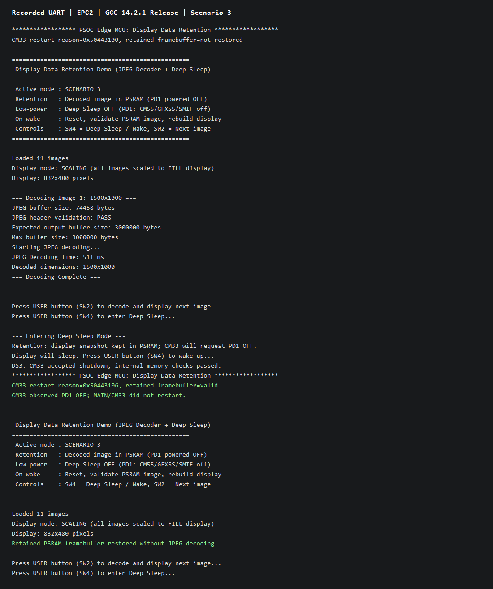

# PSOC&trade; Edge MCU: Display data retention in PSRAM

This code example demonstrates display-data retention across low-power modes on the PSOC&trade; Edge E84 device with a Waveshare 4.3-inch MIPI DSI display (800×480). Three build-time scenarios retain a framebuffer in SoCMEM or a decoded RGB565 image in externally powered PSRAM while SoCMEM or PD1 is powered off. JPEG decoding supplies the initial image. Press `SW2` to select an image and `SW4` to enter or wake from the selected low-power mode.

This code example has a three-project structure: CM33 secure, CM33 non-secure, and CM55 projects. The images are programmed to external QSPI flash. Extended boot launches the secure CM33 application, which configures protection and starts non-secure CM33. Non-secure CM33 starts CM55 and coordinates PD1 power transitions. The linker templates place the code and data needed while PD1 is off in retained internal memory; those paths cannot execute from external flash while SMIF is unavailable.

[View this README on GitHub.](https://github.com/Infineon/mtb-example-psoc-edge-gfx-data-retention-psram)

[Provide feedback on this code example.](https://yourvoice.infineon.com/jfe/form/SV_1NTns53sK2yiljn)

See the [Design and implementation](./docs/design_and_implementation.md) for the functional description of this code example.


## Requirements

- [ModusToolbox&trade;](https://www.infineon.com/modustoolbox) v3.9 (tested with v3.9)
- Board support package (BSP) minimum required version: 1.0.0
- Programming language: C
- Associated parts: All [PSOC&trade; Edge MCU](https://www.infineon.com/products/microcontroller/32-bit-psoc-arm-cortex/32-bit-psoc-edge-arm) parts


## Supported toolchains (make variable 'TOOLCHAIN')

- GNU Arm&reg; Embedded Compiler v14.2.1 (`GCC_ARM`) – Default value of `TOOLCHAIN`
- Arm&reg; Compiler v6.22 (`ARM`)
- IAR C/C++ Compiler v9.70.4 (`IAR`)
- LLVM Embedded Toolchain for Arm&reg; v22.1.0 (`LLVM_ARM`)


## Supported kits (make variable 'TARGET')

- [PSOC&trade; Edge E84 Evaluation Kit](https://www.infineon.com/KIT_PSE84_EVAL) (`KIT_PSE84_EVAL_EPC2`) – Default value of `TARGET`
- [PSOC&trade; Edge E84 Evaluation Kit](https://www.infineon.com/KIT_PSE84_EVAL) (`KIT_PSE84_EVAL_EPC4`)

## Hardware setup

This example uses the board's default configuration. See the kit user guide to ensure that the board is configured correctly.

Ensure the following jumper and pin configuration on board:

- BOOT SW pin must be in the HIGH/ON position
- J20 and J21 must be in the tristate/not connected (NC) position


### Supported display and electrical connection

**Waveshare 4.3-inch Raspberry Pi DSI 800×480 display:** Connect the FPC 15-pin cable between the display connector and the PSOC&trade; Edge E84's RPI MIPI DSI connector, as shown in **Table 1** and **Figure 1**.

<br>

**Table 1. Cable connection between display connector and kit**

 Kit name | DSI connector
 ---- | ----
 PSOC&trade; Edge E84 Evaluation Kit | J39

<br>

  **Figure 1. Display connection with PSOC&trade; Edge E84 Evaluation Kit**

  


## Software setup

See the [ModusToolbox&trade; tools package installation guide](https://www.infineon.com/ModusToolboxInstallguide) for information about installing and configuring the tools package.

Install a terminal emulator if you do not have one. Instructions in this document use [Tera Term](https://teratermproject.github.io/index-en.html).

This example requires no additional software or tools.

## Operation

See [Using the code example](./docs/using_the_code_example.md) for instructions on creating a project, opening it in various supported IDEs, and performing tasks, such as building, programming, and debugging the application within the respective IDEs.

1. Connect the Waveshare 4.3-inch MIPI DSI display to the board as described in the [Hardware setup](#hardware-setup) section

2. Connect the board to your PC using the provided USB cable through the KitProg3 USB connector

3. Open a terminal program and select the KitProg3 COM port. Set the serial port parameters to 8N1 and 115200 baud

4. After programming, confirm that "PSOC Edge MCU: Display Data Retention" and the selected retention scenario appear on the UART terminal. The terminal also displays information for each decode operation, including:
   - Selected image name and resolution
   - Decode progress and decode time (ms)
   - Render mode (crop/center or scale-to-fill)

   **Figure 2. Captured scenario 3 UART output at startup and after PD1-off recovery**

   

5. Press the USER button (`SW2`) to decode and display the next JPEG image from the image database. The application continuously cycles through all images

   **Figure 3. Decoded JPEG image output on display**

   

6. Press and release `SW4`. The terminal prints "Entering Deep Sleep Mode" and the selected retention policy; the panel and backlight turn off. Keep external PSRAM powered throughout the test

7. Press and release `SW4` again to wake the device. In scenario 1, the display uses the frame saved in SoCMEM. In scenario 2, the application recreates the framebuffers using the image saved in PSRAM. After a successful scenario 3 wake-up, CM55 restarts and restores the saved framebuffer from PSRAM without decoding the JPEG again. The terminal shows the startup banner, followed by "CM33 restart reason=0x50443106, retained framebuffer=valid", "CM33 observed PD1 OFF; MAIN/CM33 did not restart.", and "Retained PSRAM framebuffer restored without JPEG decoding." In all three scenarios, the last selected image should reappear. Press `SW2` to display the next image


## Compile-time configuration

The application behavior can be customized at build time through make variables defined in `common.mk`. After changing any option, rebuild and reprogram the application. See [Design and implementation](./docs/design_and_implementation.md#compile-time-configuration-options) for the complete list.

### Display data retention modes

The Deep Sleep demonstration uses the `RETENTION_SCENARIO` make variable to select how display data is retained while the CM55 application sleeps. The default is `PSRAM_IMAGE_PD1_OFF`.

**Table 2. Data retention and Wake-up recovery behavior**

| Value | Retention and power behavior | Wake-up recovery |
| --- | --- | --- |
| `SOCMEM_FRAMEBUFFER` | The display frame buffers remain in SoCMEM. The decoded JPEG image remains in externally powered PSRAM. The application uses regular Deep Sleep | The display controller is repointed at the retained active framebuffer. Neither framebuffer is cleared or reallocated, and no PSRAM re-blit is performed |
| `PSRAM_IMAGE_SOCMEM_OFF` | The decoded JPEG image remains in externally powered PSRAM. SoCMEM, including the display frame buffers, is powered off. The PD1 domain and SMIF context remain powered | The application restores the high-performance power profile and peripheral configuration, attempts a fast PSRAM XIP restore, and falls back to a full SMIF/PSRAM reinitialization if required. A new SoCMEM frame buffer is allocated and the image is re-rendered |
| `PSRAM_IMAGE_PD1_OFF` | Decoded pixels, a framebuffer snapshot, and checksummed metadata remain in external PSRAM. CM55 requests shutdown through IPC; retained CM33 accepts, powers off SoCMEM and PD1, and enters Deep Sleep until SW4 is pressed and released. CM55, its task/graphics state, and SMIF lose state; MAIN and CM33 are not reset | CM33 restores flash access and secure configuration, writes `APP_PD1_RESTORE`, and restarts CM55. Before BSP initialization, `main()` captures this IPC state, then initializes PSRAM/XIP and validates the retained record and data. Fresh tasks and graphics buffers restore the saved framebuffer without JPEG decoding. Invalid data after a confirmed PD1-off restart stops the application; an ordinary cold boot decodes normally |

The shared IPC states are defined in `shared/pd1_protocol.h`. `proj_cm33_ns/pd1_control.c` implements the retained coordinator, and `proj_cm33_s/pd1_restore.c` provides the secure restore service. All three projects must be built together; do not substitute a generic secure project. See [PD1 coordination and memory placement](./docs/design_and_implementation.md#pd1-coordination-and-memory-placement) for the handshake and IPC channel reservation.

The three symbolic values are defined in `common.mk` as follows:

```makefile
SOCMEM_FRAMEBUFFER=1
PSRAM_IMAGE_SOCMEM_OFF=2
PSRAM_IMAGE_PD1_OFF=3
```

#### Selecting a retention mode

You can select a mode in either of these ways:

1. Edit `RETENTION_SCENARIO` in `common.mk`:

   ```makefile
   RETENTION_SCENARIO?=PSRAM_IMAGE_SOCMEM_OFF
   ```

2. Override the default from the project root when building or programming:

   ```bash
   make build RETENTION_SCENARIO=SOCMEM_FRAMEBUFFER
   make program RETENTION_SCENARIO=SOCMEM_FRAMEBUFFER
   ```

   Replace `SOCMEM_FRAMEBUFFER` with `PSRAM_IMAGE_SOCMEM_OFF` or `PSRAM_IMAGE_PD1_OFF` to select another mode. The command-line value takes precedence over the default in `common.mk`.

After changing the retention mode, reprogram the kit.

## Adding JPEG images to the database

See [Design and implementation](./docs/design_and_implementation.md#adding-images-to-the-database) for step-by-step instructions on adding new JPEG images to the firmware database using the `proj_cm55/script/jpeg_to_array.py` converter script.

## Related resources

Resources | Links
--------- | ------
Application notes | [AN235935](https://www.infineon.com/AN235935) – Getting started with PSOC&trade; Edge E8 MCU on ModusToolbox&trade; software <br> AN239191 – Getting started with graphics on PSOC&trade; Edge MCU
Code examples  | [Using ModusToolbox&trade;](https://github.com/Infineon/Code-Examples-for-ModusToolbox-Software) on GitHub
Device documentation | [PSOC&trade; Edge E84 MCU datasheet](https://www.infineon.com/products/microcontroller/32-bit-psoc-arm-cortex/32-bit-psoc-edge-arm/psoc-edge-e84#Documents) <br> [PSOC&trade; Edge E84 MCU reference manuals](https://www.infineon.com/products/microcontroller/32-bit-psoc-arm-cortex/32-bit-psoc-edge-arm/psoc-edge-e84#Documents)
Development kits | Select your kits from the [Evaluation board finder](https://www.infineon.com/cms/en/design-support/finder-selection-tools/product-finder/evaluation-board)
Libraries | [mtb-dsl-pse8xxgp](https://github.com/Infineon/mtb-dsl-pse8xxgp) – Device support library for PSE8XXGP <br> [retarget-io](https://github.com/Infineon/retarget-io) – Utility library to retarget STDIO messages to a UART port
Tools | [ModusToolbox&trade;](https://www.infineon.com/modustoolbox) – ModusToolbox&trade; software is a collection of easy-to-use libraries and tools enabling rapid development with Infineon MCUs for applications ranging from wireless and cloud-connected systems, edge AI/ML, embedded sense and control, to wired USB connectivity using PSOC&trade; Industrial/IoT MCUs, AIROC&trade; Wi-Fi and Bluetooth&reg; connectivity devices, XMC&trade; Industrial MCUs, and EZ-USB&trade;/EZ-PD&trade; wired connectivity controllers. ModusToolbox&trade; incorporates a comprehensive set of BSPs, HAL, libraries, configuration tools, and provides support for industry-standard IDEs to fast-track your embedded application development

<br>


## Other resources

Infineon provides a wealth of data at [www.infineon.com](https://www.infineon.com) to help you select the right device, and quickly and effectively integrate it into your design.


## Document history

Document title: *CE243610 - PSOC&trade; Edge MCU: Display data retention in PSRAM*

 Version | Description of change
 ------- | ---------------------
 1.0.0   | New code example

<br>


All referenced product or service names and trademarks are the property of their respective owners.

The Bluetooth&reg; word mark and logos are registered trademarks owned by Bluetooth SIG, Inc., and any use of such marks by Infineon is under license.

PSOC&trade;, formerly known as PSoC&trade;, is a trademark of Infineon Technologies. Any references to PSoC&trade; in this document or others shall be deemed to refer to PSOC&trade;.

---------------------------------------------------------

(c) 2026, Infineon Technologies AG, or an affiliate of Infineon Technologies AG. All rights reserved.
This software, associated documentation and materials ("Software") is owned by Infineon Technologies AG or one of its affiliates ("Infineon") and is protected by and subject to worldwide patent protection, worldwide copyright laws, and international treaty provisions. Therefore, you may use this Software only as provided in the license agreement accompanying the software package from which you obtained this Software. If no license agreement applies, then any use, reproduction, modification, translation, or compilation of this Software is prohibited without the express written permission of Infineon.
<br>
Disclaimer: UNLESS OTHERWISE EXPRESSLY AGREED WITH INFINEON, THIS SOFTWARE IS PROVIDED AS-IS, WITH NO WARRANTY OF ANY KIND, EXPRESS OR IMPLIED, INCLUDING, BUT NOT LIMITED TO, ALL WARRANTIES OF NON-INFRINGEMENT OF THIRD-PARTY RIGHTS AND IMPLIED WARRANTIES SUCH AS WARRANTIES OF FITNESS FOR A SPECIFIC USE/PURPOSE OR MERCHANTABILITY. Infineon reserves the right to make changes to the Software without notice. You are responsible for properly designing, programming, and testing the functionality and safety of your intended application of the Software, as well as complying with any legal requirements related to its use. Infineon does not guarantee that the Software will be free from intrusion, data theft or loss, or other breaches (“Security Breaches”), and Infineon shall have no liability arising out of any Security Breaches. Unless otherwise explicitly approved by Infineon, the Software may not be used in any application where a failure of the Product or any consequences of the use thereof can reasonably be expected to result in personal injury.
